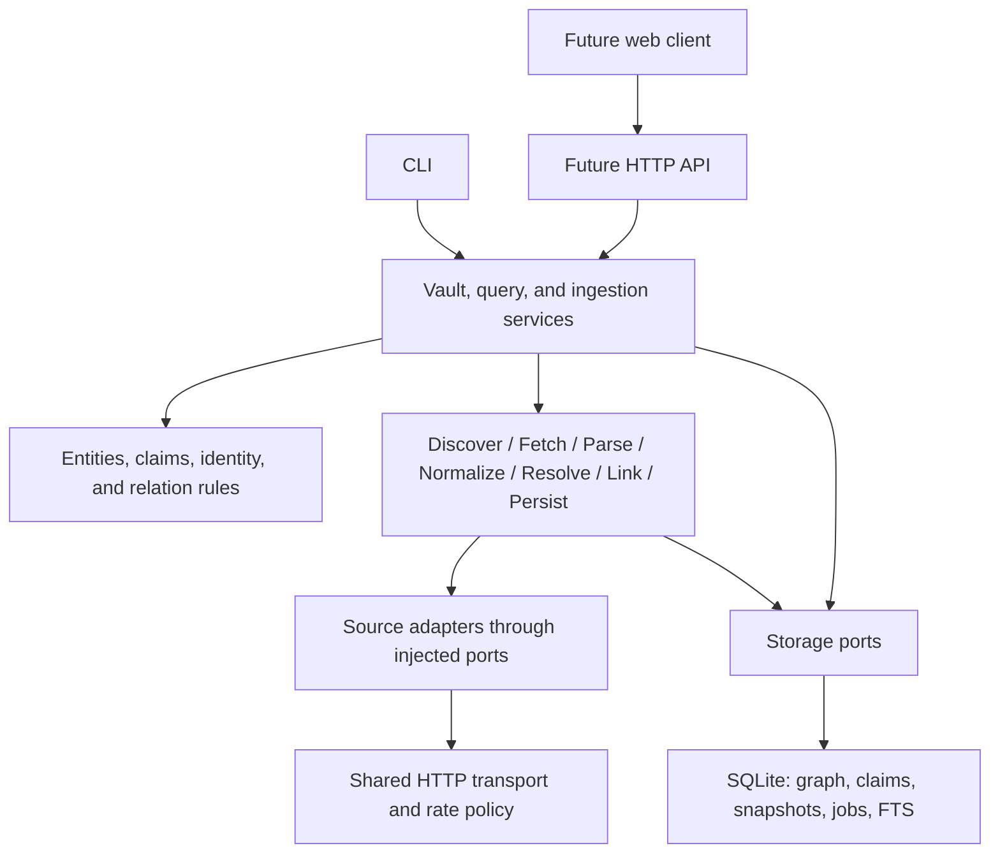

# Architecture baseline

Status: accepted planning baseline, 2026-10-26. Interfaces and table definitions below are design contracts to implement, not existing features.

## Product boundary

The graph, extraction pipeline, and provenance are the product. A single Python package owns business behavior. The CLI calls its services in process; a later HTTP API exposes the same services to a web client. Existing vault data remains usable offline. External integrations and optional enrichment add information without becoming prerequisites for opening, searching, editing, or exporting a vault.



The arrows describe calls. Core models and ports do not import adapters, SQLite, CLI, or HTTP frameworks. The application composition root wires concrete implementations to ports.

## Decisions

| Area | Initial decision | Reason and consequence |
| --- | --- | --- |
| Deployment | Modular monolith; foreground CLI execution first | Stage independence is a code boundary. Distributed execution can follow a measured need. |
| Storage | SQLite with relational entities/edges, claims, raw snapshots, jobs, and FTS5 | Matches the local-first install and permits atomic graph updates. Verify FTS5 at startup. |
| Raw content | Content-addressed BLOBs inside SQLite initially | Enables offline re-extraction without MongoDB or cross-store consistency. Apply configurable size limits. |
| Identity | Authoritative identifiers and explicit aliases; ambiguous candidates go to review | A repository, package, paper, and model remain separate entities even when they share a project. |
| Resilience | Bounded retries, durable job state, snapshots, per-provider/account throttling | No broker or Redis is required for the initial local workload. |
| Integration | Built-in adapter registry and installed entry-point plugins | Discovery inspects metadata; loading and validation happen only for selected/enabled adapters. |
| Analytics | Derived, rebuildable results on explicit graph projections | Analytics cannot silently rewrite source claims or merge entities. |
| Clients | CLI first; shared services support a later API and SPA | Client code handles presentation and transport validation. Domain decisions remain in services/core. |

SQLite documents local application storage as an intended use. This supports the choice; it does not establish capacity for our workload. Benchmark concurrent writes and representative traversals before changing storage. [SQLite guidance](https://www.sqlite.org/whentouse.html)

## Ingestion and transaction boundaries

1. Create a durable job recording normalized input, configuration fingerprint, and requested mode.
2. Discover a bounded list of targets and fetch snapshots outside graph-write transactions.
3. Persist each received snapshot and its safe response metadata in a short transaction.
4. Parse and normalize deterministically from snapshot bytes. Resolve identities and propose links.
5. In a short transaction for one target, recheck unique identities, upsert entities/edges/claims, reconcile only completely covered extraction scopes, update the search projection, record the result and mark that target committed.
6. Mark the parent job complete, partial, or failed based on its targets. A target failure leaves other committed targets intact.

Use at-least-once attempts with idempotent persistence. Do not promise exactly-once execution. Network calls never hold the SQLite write lock. A crash before graph commit rolls back that target; a crash after commit finds the durable committed-target marker on retry.

The logical stages have explicit input/output records. Initial retries restart deterministic processing from a saved snapshot rather than checkpointing every stage. Re-fetch and re-extract are separate modes: re-fetch obtains new source content; re-extract uses retained content with a selected extractor version.

## Jobs, concurrency, and events

The first runner operates in the invoking CLI process. It records attempts and a lease in SQLite so an interrupted run can be explicitly resumed. Expired leases are reclaimable with a new ownership token; a stale worker cannot commit using an old token. Reclaiming starts a new attempt. Cancellation is cooperative between stages and before commit.

Bound HTTP concurrency separately from parsing concurrency. Persist rate-limit cooldowns by provider, credential reference, and quota resource, coordinating all Devos processes using the same vault. Different vaults and third-party clients cannot be coordinated this way; provider headers remain authoritative. Store no credential values. Honor retry deadlines instead of sleeping while holding a database transaction.

Progress events are job records, not a broker dependency. A later background worker can claim the same jobs. SSE can read ordered durable events. If execution is eventually distributed, add an outbox and consumer deduplication at that point.

## Storage operations

Enable foreign keys on every connection, use short write transactions and bounded busy handling, and evaluate WAL with the initial supported local-filesystem setup. Keep vaults off network shares in the supported baseline. Use the SQLite backup API or a quiesced backup procedure rather than copying a live database file without its transaction state.

Use ordered, versioned SQL migrations. Set an application/schema version; reject unknown newer schemas and back up before upgrading. Repository ports expose operations such as unit-of-work commit, identity lookup, search, and bounded traversal. Another backend would require a new implementation, migrations, and query-equivalence tests; it is not a configuration-only swap.

## Initial package boundaries

```text
src/devos/
  core/             entities, claims, relation/type rules, identity policy
  ports/            storage, snapshots, HTTP, clock, credentials, adapter contracts
  services/         vault, query, ingest, job orchestration
  pipeline/         deterministic stage implementations and records
  storage/sqlite/   repositories, FTS projection, migrations, transaction handling
  adapters/github/ source-specific discovery, parsing, normalization
  runtime/          adapter registry, runner, transport, config, composition
  cli/              commands and presentation
tests/
  unit/             normalization, parsing, identity, reconciliation
  integration/      SQLite, retries, adapter fixtures, CLI
```

This is the planned layout, not generated application scaffolding. Select exact dependency versions when implementation starts. Keep an ordinary Python build backend distinct from the dependency/environment manager; uv can manage dependencies but is not itself the name of the selected build backend.

## Content and plugin boundaries

Store tokens only through environment variables or an OS credential provider. Redact authorization headers, credential-bearing URLs, logs, and fixtures before persistence. Untrusted README/HTML is data; never execute it. Future rendering sanitizes it. Fetching has response-size, redirect, scheme, host, and timeout limits. Fetching a repository never installs its dependencies or runs hooks.

Installed Python plugins execute with the user's privileges. Entry points provide discovery, not isolation. Treat plugins as trusted installed code; isolate untrusted implementations in separate processes only when that becomes a supported product feature.

## Conditions for revisiting the baseline

- Add a background executor when foreground ingestion no longer meets the workflow; reuse durable job contracts.
- Consider multiple machines and a broker only when measured backlog/availability needs justify independent deployment and operational ownership exists.
- Reconsider SQLite when measured writer contention or required graph-query latency remains unacceptable after indexing, bounded queries, and projection tuning.
- Move large raw artifacts behind the snapshot port if vault size or backup cost becomes a problem; define atomic references, backup, export, retention, and garbage collection together.
- Add graph analytics after reliable source relations and a representative dataset exist. Require relevance or precision evaluation before letting scores affect default behavior.

## Later product stages

After milestone 1: dependency/citation extraction and traversal; web search/detail/graph views; Hugging Face and arXiv cross-linking; GitLab and scheduling; optional semantic search and graph analytics. JSON import/round-trip validation follows the initial export format. Each stage gets its own acceptance criteria.
